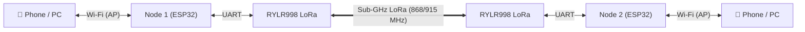

# Meshly

**An off-grid, long-range text communication terminal built with ESP32, REYAX RYLR998 LoRa transceivers, and an embedded web interface.**

[](LICENSE)
[](https://www.espressif.com/)
[](LoRa_AT_Command_RYLR998_RYLR498_EN.pdf)

> **How It Works:** Connect your phone or laptop to the node's local Wi-Fi Access Point (`192.168.4.1`) to open the web terminal. The two nodes communicate over sub-GHz LoRa radio across kilometre-scale distances. **No internet, cellular service, or app installation required.**

---

## Features

- **Zero App Installation:** Works on any device with a modern browser via local Wi-Fi soft-AP.
- **Long-Range LoRa Link:** Point-to-point text messaging using the REYAX RYLR998 (868/915 MHz, up to 2.7+ km range).
- **Embedded Web Terminal:** Retro green-on-black terminal UI served directly from ESP32 `PROGMEM` flash (no SD card or SPIFFS required).
- **Built-in Range Testing:** Interactive ping-pong tool measuring packet loss %, Round-Trip Time (RTT), RSSI, and SNR in real time.
- **Audiovisual Feedback:** Onboard RGB LED and active buzzer for transmission, reception, and link status alerts.
- **Transmit Queue:** 6-frame FIFO queue to prevent AT command collisions and packet loss.

---

## System Architecture



---

## Hardware & Wiring

Refer to [`ALL Schematic Diagrams.pdf`](ALL%20Schematic%20Diagrams.pdf) for complete breadboard, perfboard, and battery schematics.

### Pinout & Connections

| Component | Component Pin | ESP32 Pin | Notes |
|---|---|---|---|
| **RYLR998 LoRa** | VDD | **3V3** | **3.6V Max! Never connect to 5V** |
| | GND | **GND** | Common ground |
| | TXD | **GPIO 17** (RX2) | Hardware UART2 Receive |
| | RXD | **GPIO 16** (TX2) | Hardware UART2 Transmit |
| | NRST | *Leave unconnected* | Has internal 100 kΩ pull-up |
| **RGB LED** (Common Anode) | Common Anode | **3V3** | Longest leg connected to 3.3V |
| | Red Cathode | **GPIO 23** | Via 220–330 Ω resistor (Active LOW) |
| | Green Cathode | **GPIO 22** | Via 220–330 Ω resistor (Active LOW) |
| | Blue Cathode | **GPIO 21** | Via 220–330 Ω resistor (Active LOW) |
| **Active Buzzer** | (+) Positive | **GPIO 33** | Driven HIGH for audio alert |
| | (−) Negative | **GND** | Ground |
| **Capacitors** | 100–470 µF + 100 nF | Across **3V3 & GND** | Place close to RYLR998 to handle 140 mA TX spikes |
| | 1–10 µF | Across **EN & GND** | Clean power-on reset on cold boot |

### Bill of Materials (Per Node)
- 1× ESP32 Development Board (30-pin)
- 1× REYAX RYLR998 LoRa module with antenna
- 1× Common Anode RGB LED + 3× 220–330 Ω resistors
- 1× 3.3V/5V Active Buzzer
- 1× 100–470 µF electrolytic capacitor + 1× 100 nF ceramic capacitor
- 1× 1–10 µF capacitor (for EN pin)
- *Optional (Battery Operation):* 18650 Li-ion cell, TP4056 charger, MT3608 boost converter (stepped to 5V into ESP32 VIN)

---

## Status Indicators (LED & Buzzer)

| Event | LED Color | Buzzer | Duration | Meaning |
|---|---|---|---|---|
| **Boot** | Blue | Off | Double flash | System started, Wi-Fi AP ready |
| **Message Received** | Green | On | 700 ms | New chat message arrived over LoRa |
| **Message Sent** | Blue | Off | 200 ms | Message confirmed by local LoRa module |
| **Transmission Failed** | Red | On | 500 ms | Module returned error or timeout |
| **Range Test Ping OK** | Green | On | 120 ms | Round-trip packet received |
| **Range Test Lost** | Red | Off | 200 ms | Ping timed out |

---

## Getting Started

### 1. Arduino IDE Setup
1. Install [Arduino IDE](https://www.arduino.cc/en/software).
2. Install the **ESP32** board package by Espressif:
   - Add URL in **Preferences**: `https://raw.githubusercontent.com/espressif/arduino-esp32/gh-pages/package_esp32_index.json`
   - Open **Boards Manager**, search `esp32` and install.
3. Install required libraries:
   - **[ESPAsyncWebServer](https://github.com/ESP32Async/ESPAsyncWebServer)** (ESP32Async fork)
   - **[AsyncTCP](https://github.com/ESP32Async/AsyncTCP)** (ESP32Async fork)
   - **[ArduinoJson](https://arduinojson.org/)** (v6.x)

### 2. Configure & Flash Firmware
Open [`MAIN CODE/CODE/CODE.ino`](MAIN%20CODE/CODE/CODE.ino) and set node parameters:

**For Node 1:**
```cpp
#define MY_ADDRESS    1
#define DEST_ADDRESS  2
#define NETWORK_ID    18
const char* AP_SSID = "LoRaNode-1";
const char* AP_PASS = "loranode12345";  // 8+ characters required
```

**For Node 2:**
```cpp
#define MY_ADDRESS    2
#define DEST_ADDRESS  1
#define NETWORK_ID    18
const char* AP_SSID = "LoRaNode-2";
const char* AP_PASS = "loranode12345";
```

Upload to each ESP32 using board setting: **ESP32 Dev Module**.

---

## How to Use

1. **Power up both nodes.** The blue LED will double-blink.
2. **Connect your phone/laptop to Wi-Fi:**
   - Node 1: SSID `LoRaNode-1`, Password `loranode12345`
   - Node 2: SSID `LoRaNode-2`, Password `loranode12345`
3. **Open browser:** Navigate to `http://192.168.4.1`.
4. **Chat:** Type your message and press ENTER or SEND. Messages appear instantly with RSSI and SNR signal metrics.
5. **Range Test:** Click **RANGE TEST**, select an interval (e.g. 1000 ms), and press **START** to monitor live packet loss and RTT.

---

## Hardware Testing / Diagnostics

To verify the RYLR998 module and send manual AT commands:
1. Flash [`TESTING CODE/CODE/CODE.ino`](TESTING%20CODE/CODE/CODE.ino).
2. Open Serial Monitor at **115200 baud** (with **CR & NL** enabled).
3. Type `AT` and press Enter. The module should reply `+OK`.

---

## Troubleshooting

| Problem | Cause | Solution |
|---|---|---|
| **Compilation error `mbedtls_md5_starts_ret`** | Outdated `me-no-dev` library | Install the maintained [ESP32Async](https://github.com/ESP32Async/ESPAsyncWebServer) libraries |
| **Wi-Fi AP open / strange name** | Password under 8 characters | Set `AP_PASS` with at least 8 characters |
| **`FAILED (TIMEOUT)` on message send** | Supply voltage drop or reversed UART pins | Check that GPIO16 connects to module RXD and GPIO17 to TXD. Add 100–470 µF capacitor across 3V3 and GND |
| **No messages received on other node** | Mismatched address or network ID | Confirm both nodes use `NETWORK_ID = 18` and opposite `MY_ADDRESS` / `DEST_ADDRESS` |
| **Buzzer not working** | Wrong buzzer type | Use an **active** buzzer (not a passive buzzer) |

---

## Repository Structure

```
Meshly/
├── ALL Schematic Diagrams.pdf         # Complete hardware schematics & connection guide
├── LICENSE                            # MIT License
├── LoRa_AT_Command_RYLR998_RYLR498_EN.pdf # Official REYAX AT command manual
├── README.md                          # Project documentation
├── MAIN CODE/
│   └── CODE/
│       ├── CODE.ino                   # Main firmware (Wi-Fi AP, Web Server, LoRa Queue)
│       └── web_ui.h                   # Embedded Web Terminal UI
└── TESTING CODE/
    └── CODE/
        └── CODE.ino                   # Serial passthrough tool for AT command testing
```

